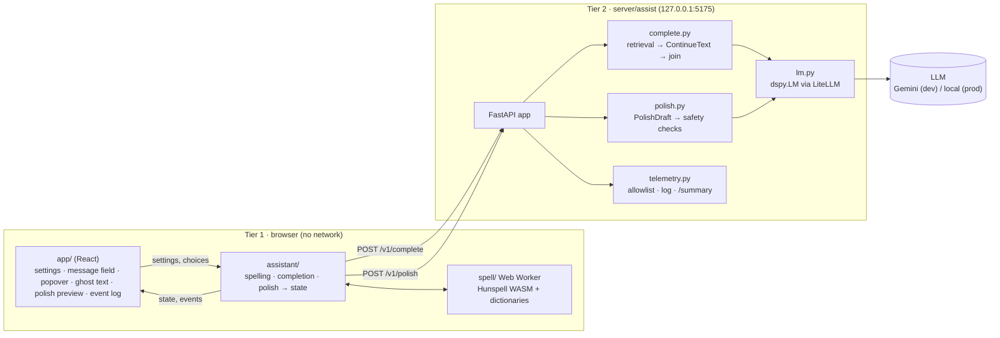
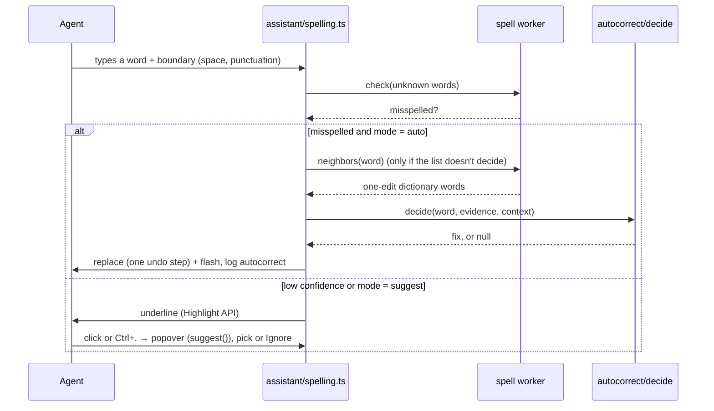
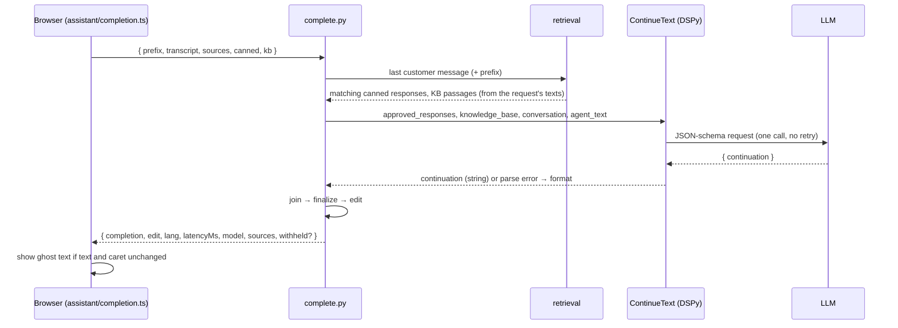

# Architecture

How the composer assistance prototype is built today. The original plan, written before any code, is the September draft in [`architecture/composer-assistance-architecture.txt`](architecture/composer-assistance-architecture.txt). This document describes what exists. The requirements are in [`requirements/`](requirements/), and the gaps against them in [`requirements/gap-analysis-60145-60254.md`](requirements/gap-analysis-60145-60254.md).

## Overview

Two tiers, split by latency and by where data may go:

| | Tier 1: the browser | Tier 2: the assistance server |
|---|---|---|
| **Does** | Spell checking, auto-correct, the ghost-text and polish UI | Inline completion, grammar polish |
| **Runs** | A React page with one message field (no browser extension); the spelling engine runs in a Web Worker | `server/`, Python (FastAPI with DSPy), on 127.0.0.1:5175; a dev stand-in for the Intelligence Engine |
| **Network** | None, except same-origin static files (WASM, dictionaries) | Calls the configured LLM: Gemini in dev, a local model in production |
| **Triggered** | On every keystroke | When typing pauses (completion), or on a button press (polish) |

The page reaches the server through Vite's `/api` proxy.

## Tier 1: the browser

One React page (`index.html`, `src/app/`) with one `contenteditable` message field. The layers, from the page down:

1. **`src/app/`** (React + Tailwind): the settings panel (saved in `localStorage`, Reset), the message field, and what is drawn around it: the suggestion popover, the ghost text, the polish preview, the event log. Components only draw and call actions; `src/app/lib/` holds the non-UI parts (settings, the conversation field, the event log).
2. **`src/assistant/`**: `createAssistant(field, options)` handles the field's events, decides, edits the text, and keeps one state object of what to draw (`popover`, `ghost`, `polish`). The page subscribes with `useAssistant`. One file per feature: `spelling.ts`, `completion.ts` (+ `completion-rules.ts`, pure), `polish.ts` (+ `polish-diff.ts`, `polish-apply.ts`), and `server.ts` for the two server calls.
3. **The algorithms**: `src/autocorrect/` (when to replace a word), `src/tokenizer/` (words with live DOM ranges), and `src/spell/` (the Hunspell worker and the page-side `SpellChecker`). The spelling eval (`eval/`) runs these same modules.

**Nothing is ever written into the editable DOM:** underlines use the CSS Custom Highlight API, the ghost text is an overlay, the popover and the polish preview sit outside the field. Every programmatic text change (an accepted suggestion, an auto-replacement, an accepted completion, an applied polish) goes through one native edit path (`execCommand('insertText')`), so Ctrl/Cmd+Z undoes it like typing.

| Module | Role |
|---|---|
| `src/spell/` | **Spelling engine.** Hunspell 1.7.4 compiled to WASM (committed build, `wasm/` + `PROVENANCE.json`), English (`dictionary-en`) and Arabic (AyaSpell, MPL 1.1) dictionaries. Runs in a Web Worker (`spell.worker.ts` → `handler.ts` → `engine.ts`). The request protocol is `load`, `spell`, `suggest`, `neighbors`, `add` and `check`. `checker.ts` is the page side: it talks to the worker, loads languages one at a time, adds the custom words, and caches results. |
| `src/tokenizer/` | **Words with live DOM ranges.** Settled words only, routed to Arabic or English by script. Excluded: URLs, emails, reference numbers, tokens with digits, `$(substitution.fields)`. |
| `src/autocorrect/` | **The auto-replace decision.** Precision first: guards (custom dictionary, all caps, names, words the customer wrote), then the curated misspellings list, then (with `list-and-rule`) a case-only fix or exactly one dictionary word one edit away. Deterministic: `neighbors` checks every one-edit variant. |
| `src/assistant/spelling.ts` | **Spell check and auto-correct.** Underlines, the popover state (suggestions, or "Revert to" for an auto-correction), Ignore (for this session), revert by Undo or the popover, the correction flash. Events: `flag`, `accept` (with the suggestion's rank), `ignore`, `autocorrect`, `revert`. |
| `src/assistant/completion.ts` | **Inline completion.** Requests after a 400 ms pause, with the caret at the end of its line and 3+ words in the sentence, sending the conversation, canned responses and KB from the settings. Tab or the forward arrow accepts all, Ctrl/Option plus the forward arrow accepts one word, typing through consumes the ghost text. A late answer is dropped if the text or caret changed. |
| `src/assistant/polish.ts` | **Grammar polish.** The draft is sent, the word diff is shown, Accept applies it (one undo step when the changes are in one text run; otherwise "Revert polish"). |

### Spelling flow (per keystroke)

## Tier 2: the assistance server (`server/`)

The server is a Python `uv` project (pinned Python 3.13, locked dependencies). It's bound to 127.0.0.1 only, and every error reply is `{ error }` with a fixed status.

| Module | Role |
|---|---|
| `assist/app.py` | FastAPI routes: `POST /v1/complete`, `/v1/polish`, `/v1/events`, `GET /summary`, `/health`. The 64 KiB body cap, CORS, and `no-store`. The page no longer sends `/v1/events` (it shows events on the page); the route stays for the server's own counters. |
| `assist/settings.py` | `.env` loading, where environment variables win. `COMPLETION_MODEL` is `auto`, `gemini`, `fake`, or any LiteLLM id; plus `COMPLETION_API_BASE`, `COMPLETION_MAX_TURNS` and `ASSIST_LLM_CACHE`. Also decides whether text leaves the machine (`external`). |
| `assist/programs.py` | **The typed DSPy programs, the only way to call an LLM.** `ContinueText` (completion) and `PolishDraft` (polish), run through `TypedJSONAdapter`, which is lenient in form (JSON inside prose or a fence, cut-off answers) and strict in type. The offline test model swaps in deterministic predictors on the same typed fields. |
| `assist/lm.py` | One `dspy.LM` through LiteLLM. Temperature 0.2, minimal reasoning, **no retries**, timeouts of 2 s (completion) and 4 s (polish). History and debug output are off; the request cache is opt-in. Error mapping: timeout → 504, unusable output → `format`, anything else → 502. |
| `assist/retrieval.py` | Lexical (BM25-style) retrieval with Arabic normalization: up to 3 canned responses and up to 2 knowledge base passages (high-confidence only). |
| `assist/complete.py` | `/v1/complete`: retrieval, `ContinueText`, then `join`, `finalize` and the `edit` derivation. |
| `assist/postprocess.py` | `join`: no space after a space, one after punctuation, a rewritten unfinished word dropped. `finalize`: one line, one sentence, 20 words, same script, no restated prefix. The join inside a word isn't checked against a dictionary (KI-6). |
| `assist/polish.py` | `/v1/polish`: `PolishDraft`, then wrapper cleanup and the safety checks. Protected tokens (placeholders, links, emails, digits) must be unchanged, the length must stay within 70–130%, and line breaks must be kept. |
| `assist/capture.py` | LLM output issues: one observation per completion or polish request with its reasons (failures such as `format`, `wrong-script`, `protected-changed`; repairs such as `rewrote-word`, `multi-sentence`). Text-free `llm-request` / `llm-issue` counters always go to telemetry (`/summary`). With `ASSIST_CAPTURE=errors` or `all`, the input, raw answer and shown text go to `capture/llm.jsonl`; `npm run capture:report` summarizes it. |
| `assist/spelling_report.py` | The spelling error report (`npm run telemetry:spelling`, and the `/summary` section): every error word, plus candidates for the custom dictionary, the misspellings lists and removal, for human review. |
| `assist/telemetry.py` + `error_types.py` | An allowlist per event type (**no text** except single words for spelling events), a JSONL log in `telemetry/` (gitignored), and the `/summary` page. The spelling error taxonomy is a port shared with the TypeScript eval through a fixture. |

### Completion request

**The model contract.** The model gets the agent's text exactly as typed and returns one field, `continuation`: the text that goes right after the caret. The instructions give one rule per ending (mid-word, a complete word, a space, punctuation), each with an English and an Arabic example. The server only adjusts what is never ambiguous.

## Data handling

- **Tier 1** never touches the network. Spelling works offline.
- **Secrets** (`GEMINI_API_KEY`) live only in the server environment or the gitignored `.env`. They never appear in replies, logs or the cache.
- **Hosted-model traffic** (Gemini) is for synthetic text only. Production uses a local LLM, so suggestions may use customer data (Req 3.7 is pending SV).
- **Events stay on the page** (the event log). The server's own telemetry (`llm-request`, `llm-issue`) stores no completion, draft, transcript or composer text; its allowlist enforces this.
- The **LLM request cache** stores prompts, so it's **off by default**. When on, it's written to the gitignored `.cache/llm/`.
- The **LLM capture log** (`ASSIST_CAPTURE`) stores request and answer text, so it's **off by default** too. When on, it's written to the gitignored `capture/`. Its issue counts are also kept text-free in telemetry, always.

## Evaluation and tooling

| Tool | What it does | Where |
|---|---|---|
| Spelling benchmark | Detection, correction, auto-replace and error types on manifest-checked synthetic datasets, with a gate against a baseline | `eval/` (TypeScript), `npm run eval` / `eval:check`, see [`EVALUATION.md`](EVALUATION.md) |
| Local completion eval | Builds test sets by cutting agents' real messages from chat or plain text; runs them through the completion program in process (canned responses and KB off); reports shown, withheld, word completion and spacing errors | `server/assist_eval/`, `npm run eval:completion:build` / `eval:completion`, local workspace `eval/local/completion/` (gitignored), see [`COMPLETION-EVAL.md`](COMPLETION-EVAL.md) |
| Tests | Vitest (Tier 1, eval tooling; DOM tests in jsdom) and pytest (server, completion eval, including every English spec scenario) | `npm test` |

## Planning and conventions

Work is planned as OpenSpec changes: `openspec/changes/` while in flight, then archived. The current behavior contract is in `openspec/specs/`, one folder per capability. [`../CLAUDE.md`](../CLAUDE.md) lists the commands, the layout and the hard constraints:
- no browser extensions;
- no network in Tier 1;
- secrets stay on the server;
- no decorations in the editable DOM;
- no GPL/LGPL terms;
- English first, Arabic first-class.

Open problems are in [`known-issues.md`](known-issues.md).
