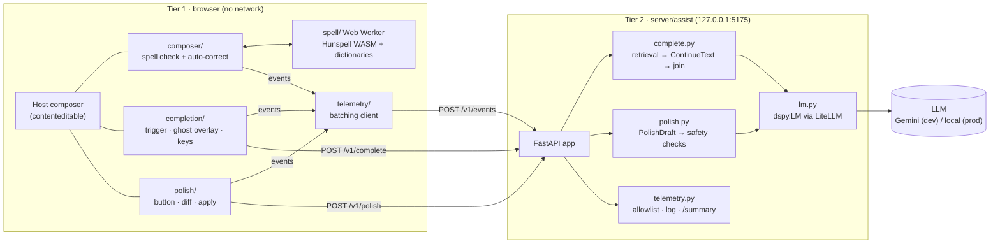
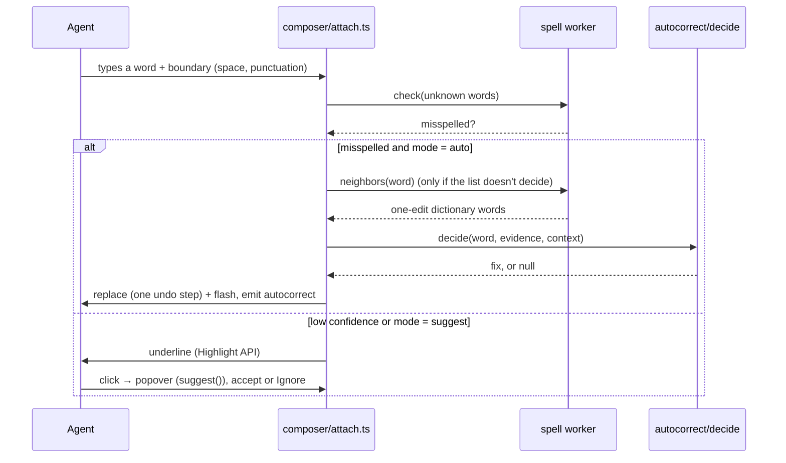
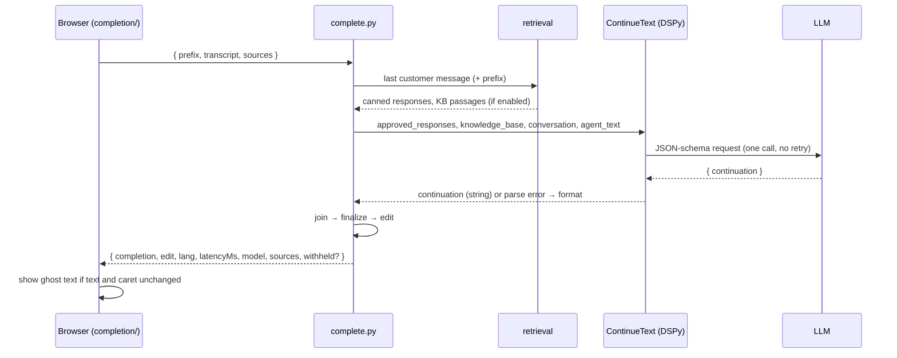

# Architecture

How the composer assistance prototype is built today. The original plan, written before any code, is the September draft in [`architecture/composer-assistance-architecture.txt`](architecture/composer-assistance-architecture.txt). This document describes what exists. The requirements are in [`requirements/`](requirements/), and the gaps against them in [`requirements/gap-analysis-60145-60254.md`](requirements/gap-analysis-60145-60254.md).

## Overview

Two tiers, split by latency and by where data may go:

| | Tier 1: the browser | Tier 2: the assistance server |
|---|---|---|
| **Does** | Spell checking, auto-correct, the ghost-text and polish UI, telemetry batching | Inline completion, grammar polish, the telemetry log and summary |
| **Runs** | Page code attached to the host's composer (no browser extension); the spelling engine runs in a Web Worker | `server/`, Python (FastAPI with DSPy), on 127.0.0.1:5175; a dev stand-in for the Intelligence Engine |
| **Network** | None, except same-origin static files (WASM, dictionaries) | Calls the configured LLM: Gemini in dev, a local model in production |
| **Triggered** | On every keystroke | When typing pauses (completion), or on a button press (polish) |

In the demo, the page reaches the server through Vite's `/api` proxy. The dev loader (`dev/ad-loader/`) calls it cross-origin from a live Agent Desktop tab.

## Tier 1: the browser

All modules are vanilla TypeScript with no UI framework, and attach to any `contenteditable`. **Nothing is ever written into the editable DOM:**
- underlines use the CSS Custom Highlight API;
- ghost text is an overlay;
- popovers and panels sit outside the editor.

Every programmatic text change (an accepted suggestion, an auto-replacement, an accepted completion, an applied polish) goes through one native edit path, so a single undo reverts it and the host gets a normal `input` event.

| Module | Role |
|---|---|
| `src/spell/` | **Spelling engine.** Hunspell 1.7.4 compiled to WASM (committed build, `wasm/` + `PROVENANCE.json`), English (`dictionary-en`) and Arabic (AyaSpell, MPL 1.1) dictionaries. Runs in a Web Worker (`spell.worker.ts`). The request protocol is `load`, `spell`, `suggest`, `neighbors`, `add` and `check`. `service.ts` adds a page-side cache, and one worker serves every composer. |
| `src/tokenizer/` | **Words with live DOM ranges.** Settled words only, routed to Arabic or English by script. Excluded: URLs, emails, reference numbers, tokens with digits, `$(substitution.fields)`. |
| `src/composer/` | **Spell check and auto-correct on a composer.** Underlines, the suggestion popover (keyboard-usable), Ignore (session list), revert by undo, the popover or Backspace, the correction flash. Emits an event for every spelling error: `flag` (underlined, once per word per message), `unresolved` (still underlined when the message is sent or cleared), `accept` (with the suggestion's rank), `ignore`, `autocorrect`, `revert`. |
| `src/autocorrect/` | **The auto-replace decision.** Precision first: guards (custom dictionary, all caps, names, words from the conversation), then the curated misspellings list, then (if the admin allows) a case-only fix or exactly one dictionary word one edit away. It's deterministic: `neighbors` checks every one-edit variant, with no time-limited ranking. |
| `src/completion/` | **Inline completion client.** Requests after a 400 ms pause, with the caret at the end of its line and 3+ words in the sentence. The ghost-text overlay follows the text direction (Arabic RTL, including a fixed-LTR host). Tab or the forward arrow accepts all, Ctrl/Option plus the forward arrow accepts one word, and typing through consumes the ghost text. A late answer is dropped if the text or caret changed. |
| `src/polish/` | **Grammar polish client.** A button, a preview panel with a word diff, apply and revert as one undo step. |
| `src/policy/` | **Admin policy and agent preference.** `resolveMode` (`off` / `suggest` / `auto`), `resolveCompletion` and `resolveGrammar` (all, or listed teams and users), the completion context sources (conversation, canned responses, knowledge base). |
| `src/telemetry/` | **Event batching.** Posts at least every 5 s and when the page is hidden. Failures never affect the composer. |
| `src/demo/` + `index.html` | **The demo page.** Chat (Enter sends) and email stand-ins, a scripted customer, **Load conversation** (chat-format text or a file, canned responses off), the settings panel with presets, the model banner, the event counter. |

### Spelling flow (per keystroke)

## Tier 2: the assistance server (`server/`)

The server is a Python `uv` project (pinned Python 3.13, locked dependencies). It's bound to 127.0.0.1 only, and every error reply is `{ error }` with a fixed status.

| Module | Role |
|---|---|
| `assist/app.py` | FastAPI routes: `POST /v1/complete`, `/v1/polish`, `/v1/events`, `GET /summary`, `/health`. The 64 KiB body cap, CORS for the dev loader, and `no-store`. |
| `assist/settings.py` | `.env` loading, where environment variables win. `COMPLETION_MODEL` is `auto`, `gemini`, `fake`, or any LiteLLM id; plus `COMPLETION_API_BASE`, `COMPLETION_MAX_TURNS` and `ASSIST_LLM_CACHE`. Also decides whether text leaves the machine (`external`). |
| `assist/programs.py` | **The typed DSPy programs, the only way to call an LLM.** `ContinueText` (completion) and `PolishDraft` (polish), run through `TypedJSONAdapter`, which is lenient in form (JSON inside prose or a fence, cut-off answers) and strict in type. The offline test model swaps in deterministic predictors on the same typed fields. |
| `assist/lm.py` | One `dspy.LM` through LiteLLM. Temperature 0.2, minimal reasoning, **no retries**, timeouts of 2 s (completion) and 4 s (polish). History and debug output are off; the request cache is opt-in. Error mapping: timeout → 504, unusable output → `format`, anything else → 502. |
| `assist/retrieval.py` | Lexical (BM25-style) retrieval with Arabic normalization: up to 3 canned responses and up to 2 knowledge base passages (high-confidence only). |
| `assist/complete.py` | `/v1/complete`: retrieval, `ContinueText`, then `join`, `finalize` and the `edit` derivation. |
| `assist/postprocess.py` | `join`: no space after a space, one after punctuation, a rewritten unfinished word dropped. `finalize`: one line, one sentence, 20 words, same script, no restated prefix. The join inside a word isn't checked against a dictionary (KI-6). |
| `assist/polish.py` | `/v1/polish`: `PolishDraft`, then wrapper cleanup and the safety checks. Protected tokens (placeholders, links, emails, digits) must be unchanged, the length must stay within 70–130%, and line breaks must be kept. |
| `assist/spelling_report.py` | The spelling error report (`npm run telemetry:spelling`, and the `/summary` section): every error word, plus candidates for the custom dictionary, the misspellings lists and removal, for human review. |
| `assist/telemetry.py` + `error_types.py` | An allowlist per event type (**no text** except single words for spelling events), a JSONL log in `telemetry/` (gitignored), and the `/summary` page. The spelling error taxonomy is a port shared with the TypeScript eval through a fixture. |

### Completion request

**The model contract.** The model gets the agent's text exactly as typed and returns one field, `continuation`: the text that goes right after the caret. The instructions give one rule per ending (mid-word, a complete word, a space, punctuation), each with an English and an Arabic example. The server only adjusts what is never ambiguous.

## Data handling

- **Tier 1** never touches the network. Spelling works offline.
- **Secrets** (`GEMINI_API_KEY`) live only in the server environment or the gitignored `.env`. They never appear in replies, logs or the cache.
- **Hosted-model traffic** (Gemini) is for synthetic text only. Production uses a local LLM, so suggestions may use customer data (Req 3.7 is pending SV).
- **Telemetry stores no completion, draft, transcript or composer text.** The server's allowlist enforces this. Spelling events carry single words.
- The **LLM request cache** stores prompts, so it's **off by default**. When on, it's written to the gitignored `.cache/llm/`.

## Evaluation and tooling

| Tool | What it does | Where |
|---|---|---|
| Spelling benchmark | Detection, correction, auto-replace and error types on manifest-checked synthetic datasets, with a gate against a baseline | `eval/` (TypeScript), `npm run eval` / `eval:check`, see [`EVALUATION.md`](EVALUATION.md) |
| Local completion eval | Builds test sets by cutting agents' real messages from chat or plain text; runs them through the completion program in process (canned responses and KB off); reports shown, withheld, word completion and spacing errors | `server/assist_eval/`, `npm run eval:completion:build` / `eval:completion`, local workspace `eval/local/completion/` (gitignored), see [`COMPLETION-EVAL.md`](COMPLETION-EVAL.md) |
| Dev loader | Attaches the layer to a live Agent Desktop tenant from DevTools, for validation only | `dev/ad-loader/`, `npm run ad-loader` |
| Tests | Vitest (Tier 1, eval tooling; DOM tests in jsdom) and pytest (server, completion eval, including every English spec scenario) | `npm test` |

## Planning and conventions

Work is planned as OpenSpec changes: `openspec/changes/` while in flight, then archived. The current behavior contract is in `openspec/specs/`, one folder per capability. [`../CLAUDE.md`](../CLAUDE.md) lists the commands, the layout and the hard constraints:
- no browser extensions;
- no network in Tier 1;
- secrets stay on the server;
- no decorations in the editable DOM;
- no GPL/LGPL terms;
- English first, Arabic first-class.

Open problems are in [`known-issues.md`](known-issues.md).
